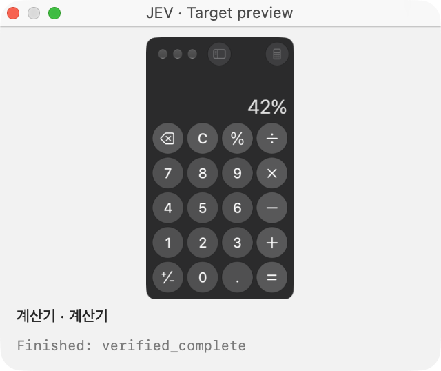
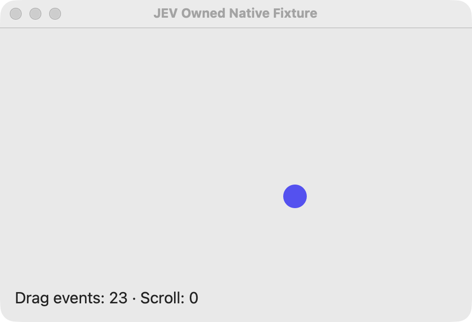
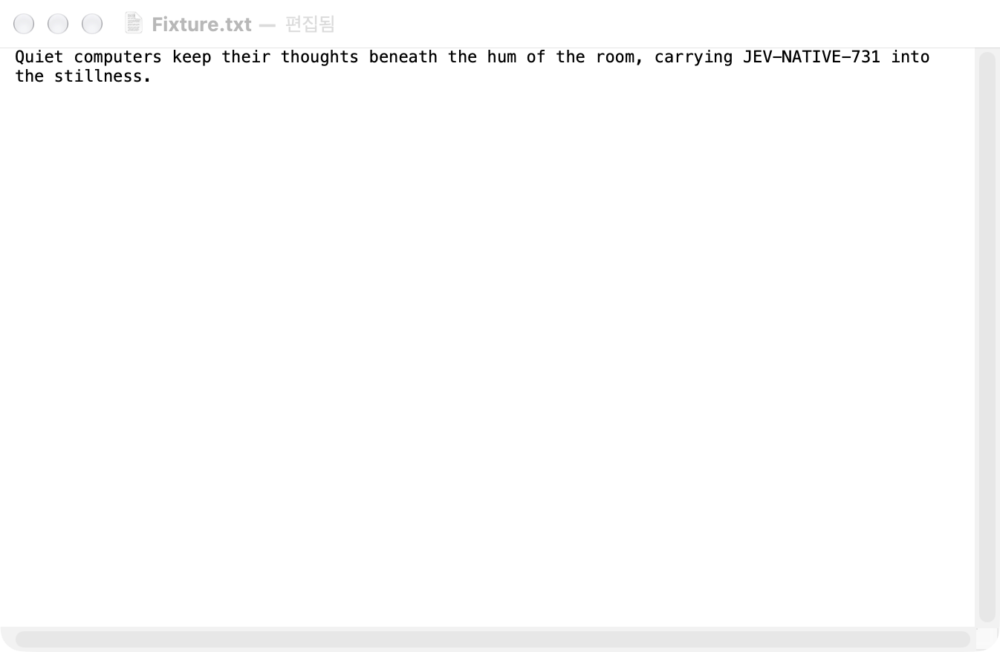
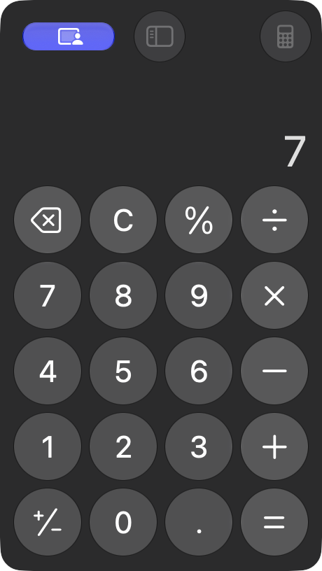

# Public verification evidence

These are sanitized historical observations from macOS 27.0.1 arm64, plus separate public-packaging checks. They do not certify other OS versions, devices, launch contexts, app compatibility, or general Codex parity. Source/build, native runtime, semantic completion and distribution evidence remain distinct.

- [Native interaction report](reports/native-verification.md): Calculator, TextEdit handoff, virtual drag/scroll, preview controls and known failures.
- [Credential setup](reports/credential-setup.md): synthetic isolated clipboard/TTY tests and no-overwrite behavior.
- [Codex/Claude skill installation](reports/skill-installation.md): destination behavior and file installation; fresh host discovery remains unverified.
- [Startup crash mitigation](reports/startup-crash.md): incident stack, unknown OS root cause, CLI startup separation and runtime preview check.
- [One-action speed benchmark](benchmark/REPORT.md): five measured trials per tool. Codex median 6.291 s; JEV median 2.037 s to exit, but only 3/5 JEV completion reports succeeded. Both reached the exact UI target 5/5. This is not a general reliable-completion speedup claim.
- `runs/`: selected JEV decision, timing, usage, handoff and owned-fixture event summaries. These omit private app inventories, AX trees, identifiers and raw transcripts; they are not executable observation/replay files.
- `checks/`: sanitized build/test/validation logs. New public artifact checks are described in PUBLICATION.md.
- `probes/`: test-only native probes, not runtime dependencies. The headless probe was unavailable on the test host (SessionCreate status 100001); exit 77 is not a product pass.
- `benchmark/run_jev_trial.py`: optional developer timing harness. Python launches the real Swift CLI; it does not choose actions or replace native execution. Set JEV_NATIVE_PATH if the command is not on PATH. The Codex side requires the actual CUA host workflow described in the report; this harness does not reproduce it independently.

## Reviewed window captures

Only independent app/fixture windows were selected. PNG ancillary metadata was stripped without changing pixels. No whole-desktop, Dock, browser, conversation or private document captures are published.

The full private validation corpus remains local. Omitted material includes raw desktop/app inventories, unrelated UI text, account/session identifiers, original crash attachments, Codex conversation/tool transcripts, credential/authentication files, temporary process files, caches and intermediate duplicate screenshots. Sanitized report references to those originals are historical evidence references, not public download promises.
